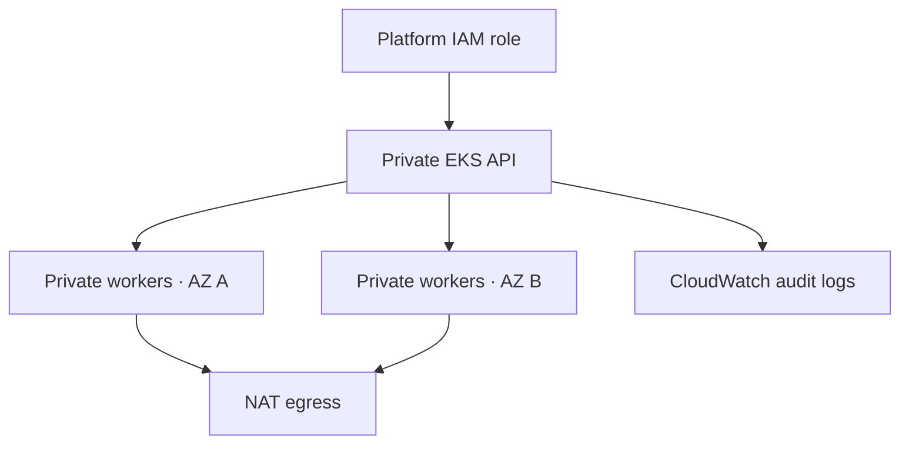

# AWS EKS Platform

[](https://github.com/hdevops9-ops/aws-eks-platform/actions/workflows/validate.yml)

A Terraform foundation for a shared Kubernetes platform: two availability zones,
private worker subnets, a private EKS API, managed workers, access entries, and
control-plane audit logs. Personal portfolio lab; not an Upstart or Citi deployment.

## Architecture



## Run

Requires Terraform 1.10+, AWS CLI credentials for a sandbox account, and network
access to the VPC through VPN, peering, or an SSM-managed host before using kubectl.
The project does not provision that access path. Do not expose the API to solve it.

```bash
cd terraform
terraform init
terraform fmt -check -recursive
terraform validate
cp terraform.tfvars.example terraform.tfvars
# Edit the Kubernetes version and administrator role.
terraform plan -out=platform.tfplan
# Review the plan and AWS costs before creating resources.
terraform apply platform.tfplan
aws eks update-kubeconfig --region us-east-1 --name platform-lab
kubectl get nodes -o wide
```

## Tradeoffs

- Lab uses one NAT gateway to reduce cost; staging/production selects one per AZ.
  A single NAT is an AZ dependency and may incur cross-AZ transfer charges.
- EKS, EC2 workers, NAT, EBS, and CloudWatch incur charges. This is not a free lab.
- Local state is the initial lab default. Before shared use, configure an encrypted
  S3 backend with versioning, S3 lockfiles, and restricted access; never commit state.
- This creates one cluster per Terraform working directory/state. Separate account
  credentials and state keys are needed for independent environments.
- Not included: organization landing zone, workload identity policies, EBS/EFS CSI
  add-ons, external ingress, multi-region DR, or a service mesh.

## Validate and capture evidence

The included CI workflow runs formatting and provider-aware validation without AWS apply.
GitHub Actions successfully completed formatting, initialization, and provider-aware
validation. See [verified checks](docs/validation.md) for the run and exact commit.
Local provider-aware validation was blocked by environment restrictions on Unix
sockets; remote GitHub validation completed successfully. It does not
prove resource creation or runtime behavior. Record the actual node distribution,
private API connectivity, and a controlled worker drain in `docs/experiment.md`
after a real deployment. No deployment has been performed by the project authoring session.

## Cleanup

Delete any workloads, Services of type LoadBalancer, and PVCs created later first.
Then run `terraform plan -destroy` and `terraform destroy`. Verify no associated
load balancers, EBS volumes, NAT gateways, or log groups remain unexpectedly.

## References

- https://registry.terraform.io/modules/terraform-aws-modules/eks/aws/21.0.3
- https://registry.terraform.io/modules/terraform-aws-modules/vpc/aws/6.0.1
- https://docs.aws.amazon.com/eks/latest/userguide/cluster-endpoint.html

## Next real improvements

Add remote state, test the deployment in a sandbox, implement workload identity,
and document node replacement and cluster upgrade procedures with observed results.
